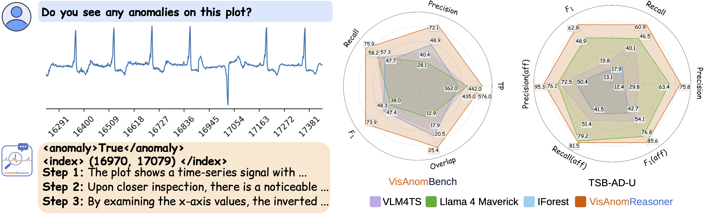

# Tiny but Trusted: Efficient Vision-Language Reasoning for Time-Series Anomaly Detection

**🎉 Accepted at NeurIPS 2026**

[Project Page](https://plan-lab.github.io/projects/VisAnom/) | [Paper](https://arxiv.org/abs/2605.30344) | [Dataset](https://huggingface.co/datasets/PLAN-Lab/VisAnomBench) | [VisAnomReasoner-7B](https://huggingface.co/PLAN-Lab/VisAnomReasoner-7B)

TL;DR: We introduce **VisAnomBench**, the first explanation-augmented benchmark for vision-language time-series anomaly reasoning, together with **VisAnomReasoner**, a parameter-efficient VLM fine-tuned to jointly localize anomalies and generate grounded explanations from time-series plots. Experimental results show substantial improvements over existing VLM and anomaly detection baselines, demonstrating that explanation-augmented supervision enables more accurate and interpretable time-series anomaly reasoning.



Given a time series plot (left top), **VisAnomReasoner** locates anomalies while providing details grounded in the plot (left bottom). Experimental results on two benchmarks demonstrate **VisAnomReasoner-7B** outperforms the strongest baselines across all metrics (right).

This repository provides code for downloading VisAnomBench and VisAnomReasoner checkpoints, running VisAnomReasoner evaluation, and fine-tuning from Qwen2.5-VL base models.

## Table of Contents

- [Overview](#overview)
- [⚙️ Get Started](#get-started)
  - [🛠️ Installation](#installation)
  - [📦 Dataset and Checkpoints](#dataset-and-checkpoints)
  - [📊 Run Evaluation](#run-evaluation)
  - [🚀 Train From Base Model](#train-from-base-model)
  - [📝 Data Notes](#data-notes)
- [📄 License](#license)
- [✉️ Contact](#contact)
- [📚 BibTeX](#bibtex)

<a id="overview"></a>

## Overview

This repository includes:

- Instructions for downloading the public VisAnomBench JSON files, plot folders, and trained checkpoints.
- Evaluation code for VisAnomReasoner.
- Supervised fine-tuning code for training VisAnomReasoner from base models Qwen2.5-VL-3B and Qwen2.5-VL-7B.

<a id="get-started"></a>

## ⚙️ Get Started

<a id="installation"></a>

### 🛠️ Installation

Clone the repository:

```bash
git clone https://github.com/PLAN-Lab/VisAnom.git
cd VisAnom
```

Create and activate a conda environment:

```bash
conda create -n visanomreasoner python=3.11 -y
conda activate visanomreasoner
pip install -r requirements.txt
```

<a id="dataset-and-checkpoints"></a>

### 📦 Dataset and Checkpoints

Hugging Face repositories:

- Dataset: https://huggingface.co/datasets/PLAN-Lab/VisAnomBench
- 3B adapter: https://huggingface.co/PLAN-Lab/VisAnomReasoner-3B
- 7B adapter: https://huggingface.co/PLAN-Lab/VisAnomReasoner-7B

Run the remaining commands from the repository root.

Download the VisAnomBench dataset into `VisAnomBench/`:

```bash
mkdir -p VisAnomBench checkpoints Qwen outputs

hf download PLAN-Lab/VisAnomBench \
  --repo-type dataset \
  --include "VisAnomBench_train.json" \
  --include "VisAnomBench_test.json" \
  --include "VisAnomBench_plot_train/*" \
  --include "VisAnomBench_plot_test/*" \
  --include "VisAnomBench_train_ts/*" \
  --include "VisAnomBench_test_ts/*" \
  --local-dir VisAnomBench
```

Download the Qwen2.5-VL base models:

```bash
hf download Qwen/Qwen2.5-VL-3B-Instruct \
  --repo-type model \
  --local-dir Qwen/Qwen2.5-VL-3B-Instruct

hf download Qwen/Qwen2.5-VL-7B-Instruct \
  --repo-type model \
  --local-dir Qwen/Qwen2.5-VL-7B-Instruct
```

Download the matching VisAnomReasoner adapters:

```bash
hf download PLAN-Lab/VisAnomReasoner-3B \
  --repo-type model \
  --local-dir checkpoints/VisAnomReasoner-3B

hf download PLAN-Lab/VisAnomReasoner-7B \
  --repo-type model \
  --local-dir checkpoints/VisAnomReasoner-7B
```

Expected local file structure:

```text
VisAnom/
|-- VisAnomBench/
|   |-- VisAnomBench_train.json
|   |-- VisAnomBench_test.json
|   |-- VisAnomBench_plot_train/
|   |-- VisAnomBench_plot_test/
|   |-- VisAnomBench_train_ts/
|   `-- VisAnomBench_test_ts/
|-- Qwen/
|   |-- Qwen2.5-VL-3B-Instruct/
|   |   `-- ...
|   `-- Qwen2.5-VL-7B-Instruct/
|       `-- ...
|-- checkpoints/
|   |-- VisAnomReasoner-3B/
|   |   |-- adapter_config.json
|   |   |-- adapter_model.safetensors
|   |   `-- ...
|   `-- VisAnomReasoner-7B/
|       |-- adapter_config.json
|       |-- adapter_model.safetensors
|       `-- ...
`-- outputs/
```

The scripts use image paths exactly as written in the JSON files. This layout matches paths such as `VisAnomBench/VisAnomBench_plot_train/train_0.png` and `VisAnomBench/VisAnomBench_plot_test/test_0.png`.

For evaluation, the expected files are:

```text
VisAnomBench/VisAnomBench_test.json
VisAnomBench/VisAnomBench_plot_test/
```

For training, the expected files are:

```text
VisAnomBench/VisAnomBench_train.json
VisAnomBench/VisAnomBench_plot_train/
```

<a id="run-evaluation"></a>

### 📊 Run Evaluation

Use the Qwen base model and VisAnomReasoner adapter with the same size.

Evaluate VisAnomReasoner-3B:

```bash
python QWEN_SFT_inference.py \
  ./Qwen/Qwen2.5-VL-3B-Instruct \
  ./checkpoints/VisAnomReasoner-3B \
  ./VisAnomBench/VisAnomBench_test.json \
  ./outputs/VisAnomReasoner_3B_test_outputs.json
```

Evaluate VisAnomReasoner-7B:

```bash
python QWEN_SFT_inference.py \
  ./Qwen/Qwen2.5-VL-7B-Instruct \
  ./checkpoints/VisAnomReasoner-7B \
  ./VisAnomBench/VisAnomBench_test.json \
  ./outputs/VisAnomReasoner_7B_test_outputs.json
```

Evaluate the Qwen2.5-VL-3B base model without the VisAnomReasoner adapter:

```bash
python QWEN_SFT_inference.py \
  ./Qwen/Qwen2.5-VL-3B-Instruct \
  ./VisAnomBench/VisAnomBench_test.json \
  ./outputs/Qwen2_5_VL_3B_base_test_outputs.json \
  --base-model
```

Evaluate the Qwen2.5-VL-7B base model without the VisAnomReasoner adapter:

```bash
python QWEN_SFT_inference.py \
  ./Qwen/Qwen2.5-VL-7B-Instruct \
  ./VisAnomBench/VisAnomBench_test.json \
  ./outputs/Qwen2_5_VL_7B_base_test_outputs.json \
  --base-model
```

Compute evaluation metrics for any output file:

```bash
python evaluate.py \
  ./outputs/VisAnomReasoner_3B_test_outputs.json \
  --gt-json ./VisAnomBench/VisAnomBench_test.json \
  --out-csv ./outputs/VisAnomReasoner_3B_test_metrics.csv
```

For other runs, replace the first argument and `--out-csv` path with the matching output filename.

<a id="train-from-base-model"></a>

### 🚀 Train From Base Model

To train VisAnomReasoner from a Qwen2.5-VL base model, run supervised fine-tuning on the VisAnomBench train JSON. We trained our models on 4× NVIDIA H100 80GB GPUs. The effective batch size is 64 (per-device batch size 2 × gradient accumulation 8 × 4 GPUs). These values are fixed in `Qwen_2_5_SFT.py`, so training on a different number of GPUs changes the effective batch size and may change results.

Training expects `VisAnomBench/VisAnomBench_train.json` and `VisAnomBench/VisAnomBench_plot_train/`.

3B:

```bash
accelerate launch --num_processes 4 --mixed_precision bf16 \
  Qwen_2_5_SFT.py \
  ./Qwen/Qwen2.5-VL-3B-Instruct \
  ./outputs/VisAnomReasoner_3B \
  ./VisAnomBench/VisAnomBench_train.json
```

7B:

```bash
accelerate launch --num_processes 4 --mixed_precision bf16 \
  Qwen_2_5_SFT.py \
  ./Qwen/Qwen2.5-VL-7B-Instruct \
  ./outputs/VisAnomReasoner_7B \
  ./VisAnomBench/VisAnomBench_train.json 
```

<a id="data-notes"></a>

### 📝 Data Notes

The JSON files use image paths relative to the repository root, such as:

```text
VisAnomBench/VisAnomBench_plot_test/<image>.png
VisAnomBench/VisAnomBench_plot_train/<image>.png
```

Run training and evaluation commands from the repository root so these paths resolve as written.

<a id="license"></a>

## 📄 License

- **Code:** [MIT License](LICENSE).
- **VisAnomBench:** [CC BY 4.0](https://creativecommons.org/licenses/by/4.0/). The underlying time series remain subject to the terms of their original sources (see Acknowledgments).
- **VisAnomReasoner adapters:** each follows the license of its base model. VisAnomReasoner-3B is subject to the [Qwen Research License](https://huggingface.co/Qwen/Qwen2.5-VL-3B-Instruct/blob/main/LICENSE) (non-commercial use only), and VisAnomReasoner-7B is released under [Apache 2.0](https://www.apache.org/licenses/LICENSE-2.0).


<a id="contact"></a>

## ✉️ Contact

If you have any questions or suggestions, feel free to contact:
* Xiaona Zhou (xiaonaz2@illinois.edu)

<a id="bibtex"></a>

## 📚 BibTeX

```bibtex
@inproceedings{zhou2026tiny,
  title={Tiny but Trusted: Efficient Vision-Language Reasoning for Time-Series Anomaly Detection},
  author={Zhou, Xiaona and Wahed, Muntasir and Yu, Tianjiao and Brif, Constantin and Lourentzou, Ismini},
  booktitle={Advances in Neural Information Processing Systems (NeurIPS)},
  year={2026}
}
```
